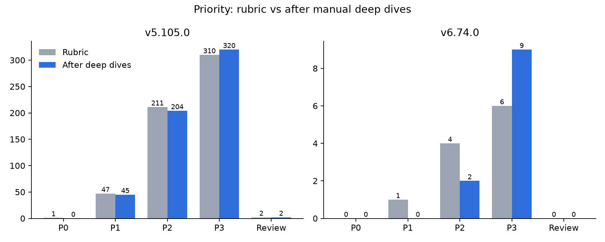

# Ghost CMS: Software Composition Analysis

An independent software supply chain assessment of [Ghost](https://github.com/TryGhost/Ghost), the open-source publishing platform. I compared an older release (v5.105.0, December 2024) with the current one (v6.74.0, November 2026): generated SBOMs, scanned them with two scanners, enriched findings with EPSS and CISA KEV, tagged each finding by where it lives in Ghost, prioritized with a written rubric, and then checked the top findings by hand in Ghost's source code.

**Full write-up:** [report/report.md](report/report.md)

## Headline

| | v5.105.0 (old) | v6.74.0 (current) |
| --- | --- | --- |
| npm packages in SBOM | 4,044 | 2,787 |
| Scanner matches (Grype) | 568 | 11 |
| Critical | 27 | 0 |
| On CISA KEV | 1 | 0 |
| P0/P1 after rubric | 48 | 1 |
| P0/P1 after manual deep dives | 45 | **0** |

- The current release has **no P0 or P1 findings**. Its only rubric P1 (jsonwebtoken) turned out to be blocked by how Ghost calls the library.
- The single CISA KEV hit, with the highest EPSS score in the whole dataset (vite, 0.75), was **dev tooling that never reaches production**.
- One finding held up under review: **express-brute**, the rate limiter on Ghost's login endpoints, has an unpatchable race condition. It stays P2 because it's real but mitigated.

Severity, EPSS, and KEV tell you what's dangerous in general. Reachability tells you what's dangerous for your app.



## Deep dives

| Package | Rubric | Final | Why |
| --- | --- | --- | --- |
| [vite@4.5.3](analysis/deep-dives/vite.md) (old) | P0 | P3 | KEV CVEs need the dev server exposed with --host; Ghost only exposes the preview server |
| [jsonwebtoken@8.5.1](analysis/deep-dives/jsonwebtoken.md) (current) | P1 | P3 | Every verify call pins an algorithm and uses a non-empty key; upgrade still recommended |
| [express-brute@1.0.1](analysis/deep-dives/express-brute.md) (current) | P2 | P2 | Race is reachable on login/reset/verification routes and has no fix; mitigated by staff device verification |

## Other findings

**Security**
- GitHub Actions grew from 26 to 78 between releases. In v5.105.0 only 1 was pinned to a commit SHA, and 3+ were pinned to a branch.
- v5.105.0 contains a committed private key file (ghost/identity-token-service/private.pem). It's gone in v6.74.0 but still in git history. Low risk: it isn't referenced by name anywhere in source or tests.
- v6.74.0 pins Node.js 22.23.4, which is fully patched, but Node 22 reaches end of life on 2027-04-30.

**Tooling**
- **Syft silently drops Ghost's entire pnpm lockfile.** I bisected it to a single `node@runtime` entry with a nested `type: variations` resolution. Without a workaround, Syft reports 136 packages instead of ~2,787.
- Syft excludes Yarn dev dependencies by default (3,170 missing packages) but not pnpm ones.
- Grype reports GHSA IDs and Trivy reports CVE IDs for the same issues. After normalizing, the scanners agree on 565/568 (old) and 11/11 (current).

## Repo layout

```
sbom/        SBOMs (Syft primary, Trivy cross-check)
scans/       Raw Grype and Trivy output
analysis/    findings.csv, overrides.csv, enrichment data, deep dives
scripts/     Pipeline scripts
charts/      Generated charts
docs/        Scope, methodology, rubric, findings log
report/      Written report
```

## Reproduce

Tools: Syft 1.56.0, Grype 0.121.1, Trivy 0.76.1, jq 1.7.1, Python 3.13 with matplotlib.

1. Clone Ghost and check out `v5.105.0` and `v6.74.0`
2. `export SYFT_JAVASCRIPT_INCLUDE_DEV_DEPENDENCIES=true`, then generate SBOMs (the current release needs the `node@runtime` workaround in [docs/methodology.md](docs/methodology.md))
3. Scan with Grype and Trivy
4. Run in order:

```bash
python3 scripts/merge_scans.py
python3 scripts/enrich.py
python3 scripts/tag_components.py
python3 scripts/prioritize.py
python3 scripts/make_charts.py
```

Scanner databases were pulled on 2026-11-05; results will drift as new advisories are published.

## Limitations

- The old release is a retrospective: its findings include advisories published after it shipped.
- Component tags come from manifests, not traced code paths. Deep dives correct this for the findings that matter most.
- Deep dives are code and config review, not live exploitation.
- Only three findings were reviewed by hand; the rest carry their rubric priority.

## Disclaimer

Independent project, not affiliated with the Ghost Foundation. Every vulnerability here is a publicly known advisory; no new vulnerabilities in Ghost are disclosed.
