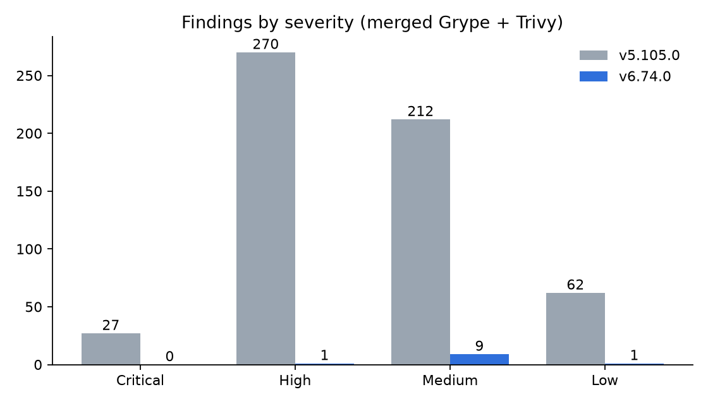
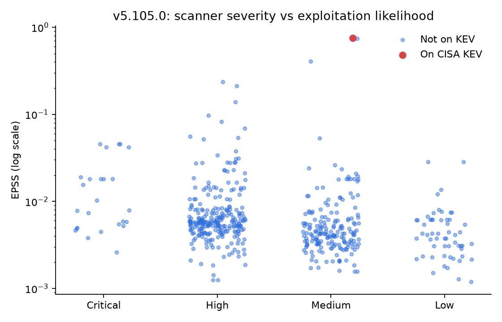
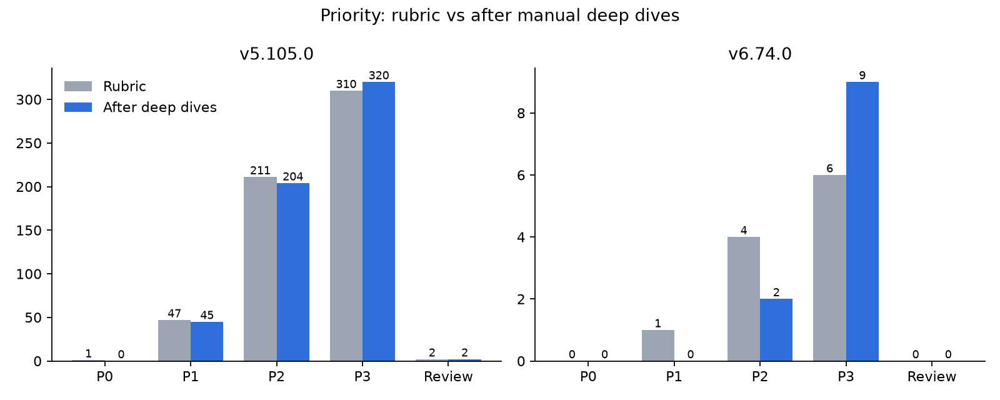

# Software Composition Analysis of Ghost CMS

Manraj Banga, November 2026

## 1. Summary

I analyzed the open-source dependencies of Ghost, a widely used publishing platform, across two releases: v5.105.0 (December 2024) and v6.74.0 (November 2026). Scanners report 568 vulnerability matches in the older release and 11 in the current one. A written prioritization rubric narrowed 582 merged findings to 49 P0/P1 items, and manual review of the source code brought the current release down to zero.

Three takeaways:

1. **Ghost's dependency hygiene improved sharply.** The package count fell by about a third, critical findings went from 27 to 0, and the only KEV-listed vulnerability is gone.
2. **Scanner scores alone are a poor guide.** The most "urgent" finding in the dataset (on CISA KEV, EPSS 0.75) was a build tool that never runs in production. The current release's top finding was blocked by defensive coding in Ghost itself.
3. **The tools need checking too.** Syft silently dropped Ghost's entire pnpm lockfile, and dev dependencies were handled differently between package managers. Without cross-checking, the current release would have looked like it had 136 packages.

## 2. Scope

| Release | Tag | Commit | Date | Package manager |
| --- | --- | --- | --- | --- |
| Old | v5.105.0 | bb9bd0e233 | 2024-12-13 | Yarn |
| Current | v6.74.0 | 13dd2ddeb8 | 2026-11-03 | pnpm 12.16.1 |

In scope: npm dependencies (runtime and dev), plus observations about GitHub Actions and the pinned Node.js runtime. Out of scope: container images, Ghost's hosted service, and live testing.

## 3. Method

1. **SBOMs.** Syft 1.56.0 produced the primary SBOMs; Trivy 0.76.1 produced cross-check SBOMs. Counts were verified against a direct parse of each lockfile.
2. **Scanning.** Grype 0.121.1 and Trivy 0.76.1, both with databases from 2026-11-05.
3. **Merging.** Findings were grouped by package and version and joined on shared CVE/GHSA aliases, giving 582 rows.
4. **Enrichment.** EPSS scores (likelihood of exploitation in the next 30 days) and the CISA Known Exploited Vulnerabilities catalog.
5. **Component tagging.** Each finding was tagged from Ghost's workspace manifests: server runtime, frontend runtime, frontend build/dev, dev tooling, or CI.
6. **Prioritization.** A 9-rule rubric (first match wins) combining KEV, EPSS, severity, and component. Manual overrides are recorded with a reason in analysis/overrides.csv, so the original rubric result is never lost.
7. **Deep dives.** For the highest-priority findings, I read Ghost's source and config to decide whether the vulnerable code is actually reachable.

## 4. Results

### SBOMs and scans

| | Old | Current |
| --- | --- | --- |
| npm packages | 4,044 | 2,787 |
| Grype matches | 568 | 11 |
| Unique vulnerability IDs | 424 | 8 |
| Critical / High / Medium / Low | 27 / 268 / 211 / 62 | 0 / 1 / 9 / 1 |
| Fix available | 549 | 10 |

After mapping GHSA IDs to CVEs, Grype and Trivy agreed on 565 of 568 matches for the old release and 11 of 11 for the current one. The few differences came from database coverage (each scanner had one advisory the other lacked) and one severity disagreement.

### Severity vs exploitability

None of the old release's 27 critical findings appear in its top 10 by EPSS. The one KEV entry was rated only MEDIUM by the scanners. Severity measures how bad a bug could be; it says little about whether anyone is exploiting it.

### Prioritization

| | P0 | P1 | P2 | P3 | Review |
| --- | --- | --- | --- | --- | --- |
| Old, rubric | 1 | 47 | 211 | 310 | 2 |
| Old, final | 0 | 45 | 204 | 320 | 2 |
| Current, rubric | 0 | 1 | 4 | 6 | 0 |
| Current, final | 0 | 0 | 2 | 9 | 0 |

## 5. Deep dives

**vite@4.5.3 (old): P0 to P3.** CVE-2025-31125 is on CISA KEV and two related CVEs have EPSS of 0.75 and 0.40. All three advisories state that only apps exposing Vite's dev server to the network (--host or server.host) are affected. Vite appears in nine Ghost apps, only in build, test, dev, and preview scripts. Five apps bind the preview server to 0.0.0.0, but none expose the dev server. Fixed versions existed within 4.x, and v6.74.0 uses Vite 8.1.6 with no findings.

**jsonwebtoken@8.5.1 (current): P1 to P3.** The 2022 CVEs need verify() called without an algorithm list, with an empty key, or with weak key types. Ghost verifies tokens in four places, and every one pins a single algorithm (HS256 or RS512) and passes a non-empty key; RSA keys are generated at 2048 bits and smaller ones are rotated. The members middleware uses express-jwt, which bundles the patched jsonwebtoken 9.0.3. I still recommend upgrading: the library is pinned to an exact 2022 version, and safety currently depends on every future call being written correctly.

**express-brute@1.0.1 (current): P2 confirmed.** Concurrent requests can race and be miscounted, letting an attacker get extra attempts past a rate limit. Every version is affected. Ghost uses it for 18 limiters, including staff login (4 free tries, then lockouts growing to 7 days), password reset, and verification codes. Counts are stored in the database, but the race is in express-brute's read-then-write logic, so that doesn't help. Impact is limited by tight limits and by staff device verification, which is on by default in production.

## 6. Tooling findings

- **Syft and pnpm.** Ghost's pnpm-lock.yaml contains two YAML documents, and Syft 1.56.0 returned 136 packages instead of ~2,787. Bisecting the lockfile isolated a single `node@runtime` entry with a nested `type: variations` resolution that makes Syft discard the whole file. Removing those entries fixed it. This is a candidate bug report for anchore/syft.
- **Dev dependency handling.** Syft excluded 3,170 Yarn dev dependencies by default but included pnpm ones. Setting SYFT_JAVASCRIPT_INCLUDE_DEV_DEPENDENCIES=true made both consistent.
- **ID normalization.** Grype reports GHSA IDs and Trivy reports CVE IDs for the same issues, so naive comparison would show large disagreement that isn't real.

## 7. Other observations

- **CI/CD supply chain.** GitHub Actions grew from 26 to 78. In v5.105.0, 1 was pinned to a commit SHA and 3+ were pinned to a branch, so upstream changes would flow straight into Ghost's CI.
- **Committed key.** v5.105.0 includes ghost/identity-token-service/private.pem. It was removed by v6.74.0 and is not referenced by name in source or tests, but it remains in git history.
- **Node.js runtime.** v6.74.0 pins Node 22.23.4, the latest 22.x security release, but Node 22 reaches end of life on 2027-04-30.

## 8. Recommendations for Ghost

1. Upgrade jsonwebtoken from the exact 8.5.1 pin to 9.x. Low effort, since 9.0.3 already runs inside Ghost via express-jwt.
2. Replace express-brute with a maintained rate limiter that uses atomic counters.
3. Pin GitHub Actions to commit SHAs.
4. Plan the move to Node 24 before April 2027.

## 9. Limitations

- The old release is retrospective; many of its advisories were published after it shipped.
- Tags come from manifests, not traced call paths. Deep dives correct this only for the three findings reviewed.
- Conclusions come from code and config review, not live testing.
- Scanner databases are a snapshot from 2026-11-05.
